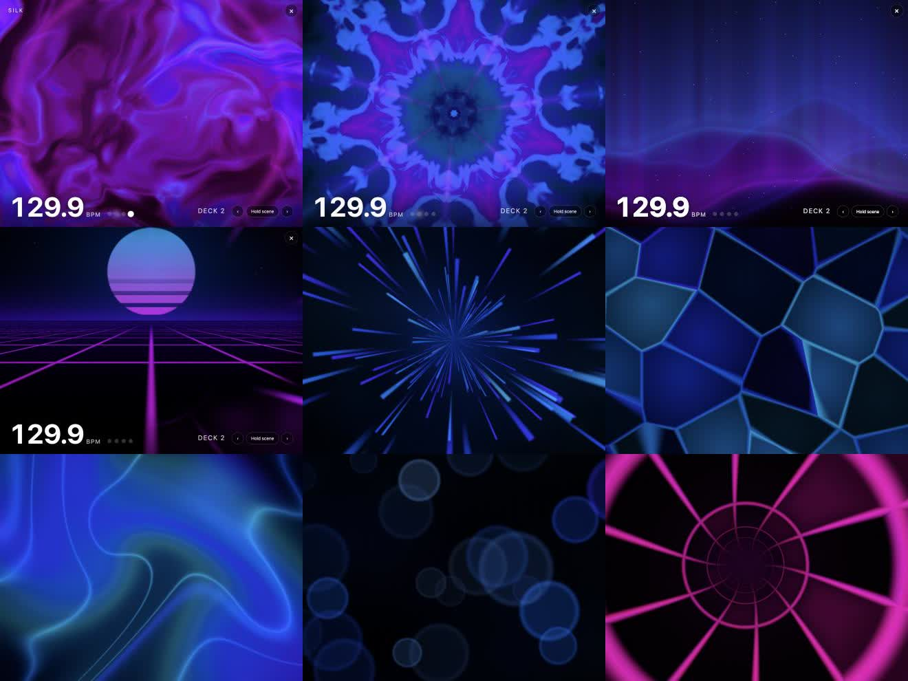

# Night Owl

*by Groove Formula*

**[evands.github.io/night-owl](https://evands.github.io/night-owl/)** has a tour and a live demo of the visualizer.

Philips Hue lights, and a full-screen visualizer, locked to the beat of
Pioneer CDJs.

Most light-sync apps listen through a microphone, so they always react
after the sound. Night Owl reads the beat information the decks already
broadcast over their PRO DJ LINK network, knows when each beat is coming,
and sends the lights their cue slightly early so the light lands on the
beat. The program is a single file called `cdjhue`.



## What it does

- **Beat-locked lights.** Every beat, with the downbeat hitting harder.
  Measured on a wired computer: the lights reach half brightness within
  about 25 ms of the beat.
- **Effects that know the room.** Pulses, waves, chases and sweeps travel
  across the lights' real positions, taken from your Hue Entertainment
  area.
- **Build-ups and hits.** The last bar before a change rolls faster and
  brighter, and the next downbeat lands as a white hit.
- **Presets.** Switch the whole look from one menu; save, rename and
  delete your own.
- **A visualizer.** Twelve full-screen scenes in the lights' colours, for
  a TV or projector, moving on the same beat.
- **A control page** for any phone or computer on the network, with a live
  map of the room.
- **Optional track awareness.** Follows the leading deck through a blend
  and lands changes on the track's phrases (intro, verse, chorus).

## What you need

**DJ gear**

- Pioneer DJ players with a LINK port. Developed and tested with three
  CDJ-2000NXS2 players and a DJM-900NXS2 mixer. Other PRO DJ LINK players
  should work; all-in-one controllers driven from a laptop do not
  broadcast this information.
- A network switch, and a cable from each player's LINK port to it. The
  mixer's LINK port is optional but recommended: with it, the lights only
  follow decks whose channel is live.
- Tracks analysed in rekordbox, so the decks know where the beats are. The
  optional phrase features need phrase analysis from rekordbox 6 or later.

**Lights**

- A Philips Hue Bridge (the square one). Tested with model BSB002.
- Colour-capable Hue lights.
- A Hue **Entertainment area** containing those lights (see step 2).

**A computer**

- Windows, macOS or Linux, on the same network as the bridge and the
  decks. It can be a small always-on machine.
- **Use a network cable if you can.** Over Wi-Fi the decks' beat packets
  arrive up to a fifth of a second late and some are lost. The program
  compensates, but in testing the timing wobble was about 3 ms wired
  against about 200 ms on Wi-Fi.
- [Go](https://go.dev/dl/) to build it. The project is written for Go
  1.27; any Go from 1.21 on fetches that version by itself.

## Setting up

### 1. Wire the decks to your network

Connect each player's LINK port to the switch, and the switch to your
router (or to a switch that is on your home network). Turn the decks on
**after** that cable is in: decks that start without a router give
themselves `169.254.x.x` addresses, which a computer will not hear without
an extra step (see [If the decks do not show up](#if-the-decks-do-not-show-up)).

### 2. Create a Hue Entertainment area (strongly recommended)

Night Owl streams to a Hue Entertainment area, and it uses that area for
more than a list of lights: **the area is where it learns where each light
is in the room.** Waves, chases, the two-sides effect, the colour spread,
"outward from the DJ booth" and the room map on the control page all work
from those positions.

In the Hue app:

1. Open **Settings > Entertainment areas** and create a new area.
2. Choose the **music** type ("Listening to music") if the app asks.
3. Add every light you want in the show. Gradient lights and light strips
   can contribute several segments.
4. **Drag each light to where it really is in the room, and set its
   height.** Take a minute over this. If the lights are left in a clump or
   in the wrong places the show still runs, but a wave will not visibly
   travel across the room and the two halves will not be the two halves.
5. Save the area.

You can edit the positions later; restart the program to pick up changes.

**More than ten lights.** A Hue Entertainment area holds at most ten
lights, and a bridge streams to only one area at a time. For a bigger room,
make further areas for the remaining lights, placing them in the same room
layout as the first, and tick them all under **Lights** on the control
page. The area with the most channels is streamed on every beat, as
normal. Lights that are only in the other areas follow by ordinary
commands, which the bridge limits to about ten a second: they take the
show's colours and take turns flashing, one light on each beat, the turn
moving across the room. An option under **Lights**, off by default,
flashes two on each beat instead; that is about all the bridge accepts, so
turn it off again if the followers lag or the streamed lights stutter. All of them share one room layout, so the colour
spread and the direction of travel run across the lot. Put the lights
that matter most in the biggest area.

### 3. Build the program

```
git clone https://github.com/evands/night-owl
cd night-owl
go build -o cdjhue .
```

For another kind of computer, name it when building:

| For | Command |
|---|---|
| Windows | `GOOS=windows GOARCH=amd64 go build -o cdjhue.exe .` |
| Linux, Intel/AMD | `GOOS=linux GOARCH=amd64 CGO_ENABLED=0 go build -o cdjhue .` |
| Linux, ARM (Raspberry Pi) | `GOOS=linux GOARCH=arm64 CGO_ENABLED=0 go build -o cdjhue .` |
| Mac | `go build -o cdjhue .` |

### 4. Run it and pair with the bridge

Start `cdjhue` (double-click `cdjhue.exe` on Windows). The first time:

1. It finds your Hue bridge and asks you to **press the round button on
   top of the bridge**. With several bridges, the one whose button you
   press is the one it pairs with. It asks again every two minutes until
   you do.
2. If the bridge has more than one Entertainment area it asks which to
   use; Enter takes the first music area.

After that it starts straight away every time, takes over the lights, and
opens the control page in a browser. The page's address is also printed
for phones on the same network (port 8600).

Per system:

- **Windows:** the program is unsigned, so choose "More info" then "Run
  anyway". When Windows Firewall asks, allow it on your network, or it
  cannot hear the decks. rekordbox must be closed on the same computer
  (it holds the port the decks' beats arrive on).
- **Mac:** run it from the Terminal app, and allow Terminal to find
  devices on the local network if macOS asks.
- **Linux:** see [An always-on server](#an-always-on-server).

Stopping the program (close the window, or Ctrl-C) hands the lights back.

### 5. Tune the timing

On the control page, **Light lead** is how early the lights are cued to
cancel out the Hue system's own delay. The default (90 ms) was measured on
a wired computer and is a good start. Raise it if the lights feel late,
lower it if they feel early.

For a precise setting, film the lights in slow motion with the music
audible, with the effect set to Pulse and the floor at 0%, and compare
each flash with its kick. On Wi-Fi the best value is usually a little
higher.

Then pick a preset and make it yours.

## The control page

Open `http://<the computer's address>:8600` on any device on the network.
Changes apply instantly, are saved, and show up on every other open copy
of the page.

- **Preset:** the whole look in one menu. *Save* stores your changes into
  the current preset, *Save as* makes a new one, *Rename* and *Delete* do
  what they say. A preset holds colours, effect, brightness, pulse shape,
  build-ups and visualizer pacing. It does not hold the light lead or the
  deck options, which belong to your setup. It starts with Classic,
  Blue-Green Chase, Sunset Wave, Neon Nights, Deep Ocean, Ember Glow,
  Aurora Sparkle and Candy Shop.
- **Timing:** light lead, how long each pulse takes to fade, an optional
  ramp-up before the beat, and how long to wait before a silent deck
  counts as stopped.
- **Brightness:** the peak of each pulse, the level between pulses, and
  how hard beats 2 to 4 hit compared with the downbeat.
- **Movement:** the effect (pulse, wave, alternate, sides, chase, bounce,
  sparkle, or auto to rotate through them), the direction effects travel
  (left to right, back to front, floor to ceiling, or outward from the DJ
  booth: tap the room map to place the booth), and build-ups.
- **Colour:** either a hue range or hand-picked colours, how often the
  colour changes, the crossfade, and how much it varies across the room.
- **Visualizer:** how often its scene changes.
- **Deck selection** and **Track structure and blends:** see below.

## The visualizer

The **Visualizer** button opens a full-screen light show in the lights'
current colours: Silk, Tunnel, Kaleidoscope, Aurora, Horizon, Bokeh, Warp,
Glass, Liquid, Prism, Ribbons and Hive. Every scene moves on the beat and
changes colour with the lights. Scenes change on a bar line and blend into
each other, each appearance is varied, and when the lights do a build-up
the visualizer builds with them and cuts to a new scene on the hit.

- For a TV or projector, open the control page's address with `#viz` on
  the end: `http://<address>:8600/#viz`.
- Move the mouse or tap for the tempo and the scene buttons. Left and
  right arrows (or a swipe) change scene, the space bar holds the current
  one, keys 1 to 9 pick a scene, Esc closes.
- It needs a browser with WebGL, and lowers its own resolution on a
  computer that cannot keep it smooth.

## Track structure and blends (optional)

By default the program only listens. Turning on **Join the DJ network as a
player** makes it announce itself to the decks as one more player, the way
Beat Link Trigger does. The decks then send it their status, and it can
ask them about the loaded track:

- **Blends:** the lights follow the tempo master.
- **Phrases:** colour and effect changes land on the track's phrase
  boundaries, and build-ups lead into phrases that are more intense.
- **Energy:** quiet sections pulse dimmer.
- **Drops:** a white hit on the first beat of a chorus.

It takes the highest free player number from 4 down to 1; phrases need one
of those four, so with four real decks only the blend feature works. If a
real device appears with the same number the program steps aside at once.
Only the copy that is driving the lights joins.

Treat this as newer and less proven than the rest. In early testing the
decks felt sluggish once while it was on, which was never explained and
has not recurred. If your decks ever feel slow with it on, turn it off.
With it on, the log records every change of SYNC and tempo master on each
deck.

## Several computers

More than one copy can be set up for the same lights. The copy started
most recently takes them; a copy that loses them waits and takes over
again when they are free. Start a copy with `-wait` to have it stand by
from the start instead of taking the lights (the Linux service does this),
which makes a good always-on fallback behind a main computer.

## An always-on server

For a Linux machine that should run this from boot, the `linux` folder has
a systemd service. Copy the built `cdjhue`, the files in `linux`, and this
README into one folder on that machine and run:

```
sudo sh install.sh <user to run as> [hue bridge address]
```

It installs under `/opt/cdjhue`, starts at boot and restarts if it stops,
opens the firewall (ufw) for the control page and the decks, and keeps a
`169.254` address on the wired connection so decks on self-assigned
addresses are heard. Press the bridge button when it first starts.

- Logs: `journalctl -u cdjhue -f`
- Update later without the administrator password:
  `sh update.sh <new cdjhue>` as the service's user.

On Windows, `cdjhue autostart on` makes it start minimised when you sign
in; `cdjhue autostart off` undoes it.

## Troubleshooting

### If it will not start

- **"cannot listen for beats on UDP port 50001"**: another program on the
  same computer holds the port. rekordbox does, and its helper
  `PSvLinkSysMgr.exe` can keep holding it after rekordbox is closed. Close
  both, or run Night Owl on a different computer from rekordbox.
- **"cdjhue is already running on this computer"**: only one copy per
  computer. Its control page opens so you can find it.

### If the decks do not show up

The control page shows a red banner when no deck or mixer is heard.

- Check the switch is cabled to your router and the firewall allows the
  program.
- Decks that started before they could reach the router are on
  `169.254.x.x` addresses. Either restart them with the cable in, or give
  the computer a second address in that range:

  Windows, in an administrator PowerShell (use your adapter's name):

  ```
  netsh interface ipv4 set interface "Ethernet" dhcpstaticipcoexistence=enabled
  netsh interface ipv4 add address "Ethernet" 169.254.57.58 255.255.0.0
  ```

  Mac: `sudo ifconfig en0 alias 169.254.57.57 netmask 255.255.0.0`
  (this one is lost at restart).

  Linux: the service installer does this for you.

- `cdjhue listen` prints the gear and beats it can hear, without touching
  the lights.

### If the lights are off the beat

- **Consistently late or early:** adjust Light lead.
- **Wandering:** the computer is probably on Wi-Fi; the control page warns
  when it sees this. Use a cable.
- **Out of step with the kick on some tracks only:** the lights follow the
  track's beat grid from rekordbox. If a track's grid is off, so are the
  lights; fix the grid in rekordbox.
- **A little scatter always remains** (about 25 ms either way): the bridge
  only updates bulbs 25 times a second.

### If the lights do nothing

- **"Lights: not streaming ... another app"** on the control page: another
  app (Hue Sync, a phone app, another copy) holds the Entertainment area.
  Close it, or restart this copy to take the lights.
- **Idle colours only:** no deck is playing on a live mixer channel. If
  there is no DJM on the link, turn off "Only follow decks that are live
  on the mixer".

## Commands and options

```
cdjhue [options] [run | setup | listen | autostart on|off]
```

| Command | What it does |
|---|---|
| `run` (the default) | Sync the lights; pairs first if needed |
| `setup` | Pair with a bridge and choose the area again |
| `listen` | Print what the decks send, without touching the lights |
| `autostart on` / `off` | Start with Windows at sign-in, or stop |

| Option | What it does |
|---|---|
| `-open=false` | Do not open the control page in a browser |
| `-ui :8600` | Address and port of the control page |
| `-bridge <address>` | Pair with this bridge instead of searching |
| `-wait` | Stand by if another app is driving the lights at start |
| `-retry` | Keep trying if the bridge is unreachable at start |
| `-config <file>` | Use a different settings file |
| `-link-number <n>` | Player number to use when joining the DJ network |

Settings, presets and the bridge pairing are kept in `cdjhue.json`, with
the last run's log beside it, in `%APPDATA%\cdjhue\` on Windows,
`~/Library/Application Support/cdjhue/` on a Mac and `~/.config/cdjhue/`
on Linux. The file holds your bridge key: do not share it.

## How it works

- **Listening.** Players broadcast a packet on every beat (UDP port 50001)
  with the tempo and the position in the bar; the mixer broadcasts which
  channels are live. Night Owl only listens to these.
- **A steady beat clock.** Packets can arrive late but never early, so the
  clock follows the earliest recent arrivals and free-runs between them.
  Lost packets do not cost beats.
- **Leading the lights.** Colours are streamed to the bridge 50 times a
  second over the Hue Entertainment API, plus one frame at the exact
  moment each pulse begins, all shifted early by the light lead.
- **The page.** The control page and visualizer are served by the program
  itself; the visualizer keeps its own beat clock, corrected ten times a
  second.

## Development

```
go test ./...
go vet ./...
```

The code is plain Go with two direct dependencies: `pion/dtls` for the
bridge's encrypted stream and `golang.org/x/sys`. `index.html` and
`viz.js` are embedded in the program.

The website lives in `docs/` and is served by GitHub Pages. Its demo runs
a copy of the visualizer, so after changing `viz.js` run
`cp viz.js docs/viz.js`.

## Acknowledgements

The PRO DJ LINK details come from Deep Symmetry's
[DJ Link Ecosystem Analysis](https://djl-analysis.deepsymmetry.org/), the
work behind Beat Link Trigger. Night Owl is not affiliated with or
endorsed by AlphaTheta / Pioneer DJ or Signify / Philips Hue.

## Licence

MIT. See [LICENSE](LICENSE).
